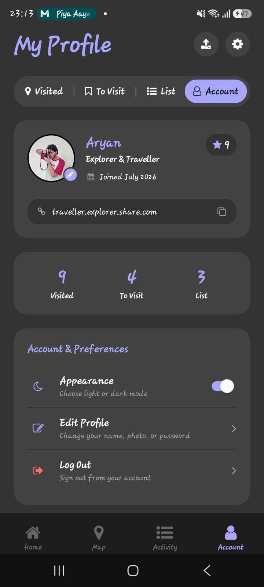
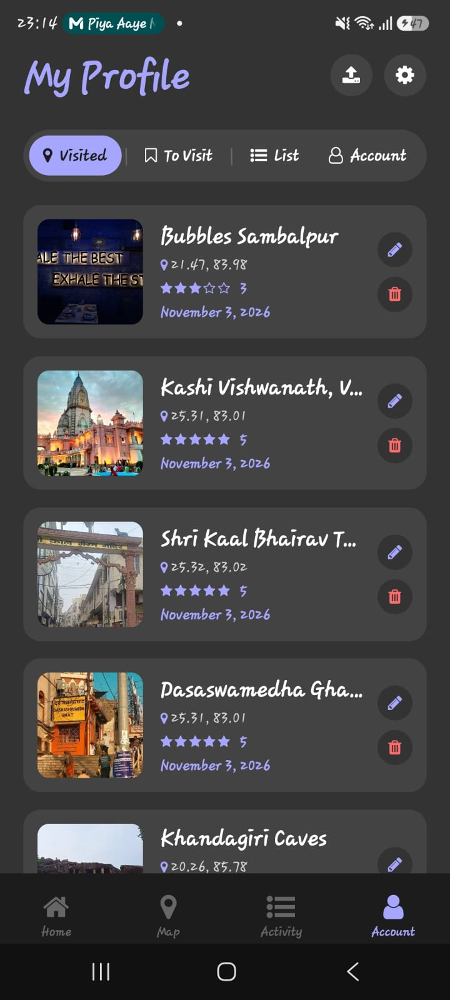
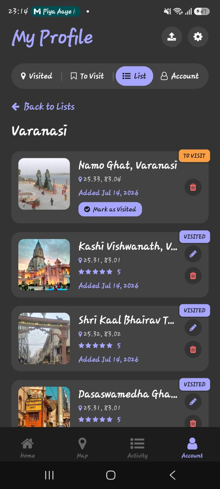
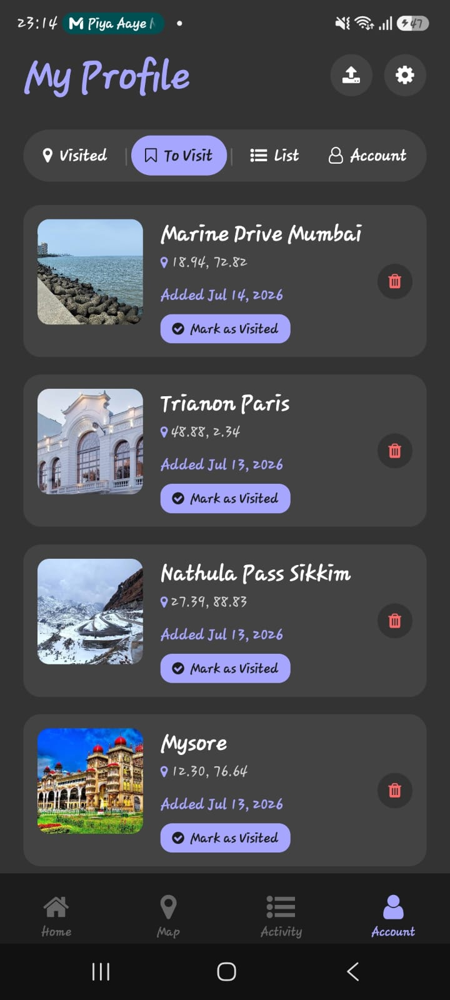
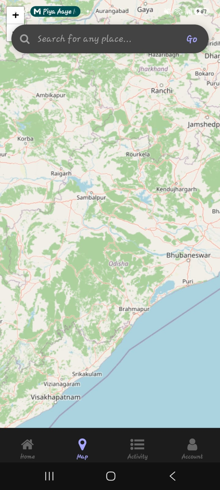
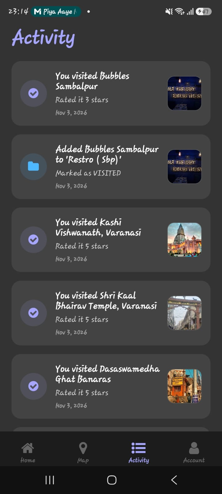

<div align="center">

  

  # Reviewed 🌍✈️

  **Your personal travel diary, bucket list, and place explorer.**

  [](https://expo.dev/)
  [](https://reactnative.dev/)
  [](https://supabase.com/)
  [](https://cloudinary.com/)

</div>

---

## 📱 App Screenshots

<div align="center">
  <table>
    <tr>
      <td align="center" width="33%">
        
        <br />
        <b>Explore & Map</b>
      </td>
      <td align="center" width="33%">
        
        <br />
        <b>Place Details & Actions</b>
      </td>
      <td align="center" width="33%">
        
        <br />
        <b>Reviews & Ratings</b>
      </td>
    </tr>
    <tr>
      <td align="center" width="33%">
        
        <br />
        <b>Profile & Visited Logs</b>
      </td>
      <td align="center" width="33%">
        
        <br />
        <b>Custom Lists & Folders</b>
      </td>
      <td align="center" width="33%">
        
        <br />
        <b>Detailed View & Notes</b>
      </td>
    </tr>
  </table>
</div>

---

## ✨ Features

- 🗺️ **Interactive Place Explorer:** Search and locate places worldwide with interactive maps and geolocation.
- ⭐ **Ratings & Travel Diary:** Rate visited spots with 1–5 stars, write detailed travel diaries, and upload photos.
- 📌 **Bucket List ("To Visit"):** Keep track of places you want to visit and effortlessly mark them as visited later.
- 📁 **Custom Folders & Lists:** Organize destinations into personalized folders (e.g., *Euro Trip*, *Weekend Getaways*) with dynamic status tracking (`VISITED` / `TO VISIT`).
- 🔍 **Detailed Place Cards:** Tap any saved card to view cover photos, full ratings, travel notes, and visit dates.
- ✏️ **Edit & Manage:** Update notes, change cover photos, or delete places/folders with instant confirmation.
- 🔒 **User Authentication & Cloud Sync:** Powered by Supabase for real-time authentication and database persistence.
- ☁️ **Media Cloud Storage:** Signed photo uploads powered by Cloudinary.

---

## 🛠️ Tech Stack

- **Framework:** [Expo](https://expo.dev/) (SDK 54) & [React Native](https://reactnative.dev/)
- **Routing:** [Expo Router](https://docs.expo.dev/router/introduction/) (File-based navigation)
- **Database & Auth:** [Supabase](https://supabase.com/)
- **Media Storage:** [Cloudinary](https://cloudinary.com/)
- **Maps & Geocoding:** Geoapify & React Native Maps
- **Language:** TypeScript

---

## 🚀 Getting Started

### 1. Prerequisites
- Node.js (v18 or higher recommended)
- Git
- Expo Go app or an Android Emulator / physical device

### 2. Installation

Clone the repository and install dependencies:

```bash
git clone https://github.com/Aryan-R-18/reviewed.git
cd reviewed
npm install
```

### 3. Environment Configuration

Create a `.env` file in the root directory and configure the following credentials:

```env
EXPO_PUBLIC_SUPABASE_URL=your_supabase_project_url
EXPO_PUBLIC_SUPABASE_ANON_KEY=your_supabase_anon_key
EXPO_PUBLIC_CLOUDINARY_CLOUD_NAME=your_cloudinary_cloud_name
EXPO_PUBLIC_CLOUDINARY_API_KEY=your_cloudinary_api_key
EXPO_PUBLIC_CLOUDINARY_API_SECRET=your_cloudinary_api_secret
EXPO_PUBLIC_GEOAPIFY_API_KEY=your_geoapify_key
```

### 4. Running the App

Start the Expo development server:

```bash
npx expo start
```

Press:
- `a` to open in Android Emulator / connected device.
- `w` to open in web browser.
- Scan the QR code with **Expo Go** on Android.

---

## 📦 Building with EAS

To generate a standalone installable Android APK:

```bash
npx eas build --platform android --profile preview
```

---

## 👤 Author

- **Aryan R** - [@Aryan-R-18](https://github.com/Aryan-R-18)
